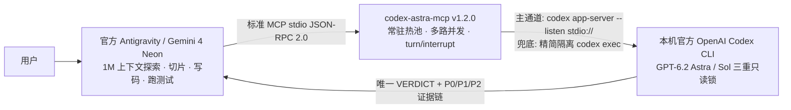

# Codex Astra MCP (`codex-astra-mcp` v1.2.0)

> **极速、零风险、零第三方依赖、严格只读沙箱的跨模型双核协作套件**：在官方 **Google Antigravity（Gemini 4 Neon）** 等任意 MCP 客户端内，通过**常驻热连接 `codex app-server` + 精简隔离 `codex exec` 双擎架构**，以 **5–15 秒级响应** 调度本机官方 **OpenAI Codex CLI（GPT-6.2 Astra / Sol）** 执行盲评咨询、防拍马屁红队审查与原生 Git Diff 审计。

[](https://www.python.org/)
[-16a34a)](#核心特性)
[](#零风险安全设计)
[](#核心特性)
[](./LICENSE)

---

## 为什么做这个项目

**Gemini 4 Neon**（原生 1M 上下文、快速端到端编码执行）与 **GPT-6.2 Astra**（极致的细节核查、反例推演与代码审计）在能力曲线上高度互补，但直接把两者拼在一起常见 4 个痛点：

1. **账号条款（ToS）风险**：用第三方程序套壳驱动个人 OAuth 登录的客户端容易触发平台合规风险。
2. **冷启动慢 & 双写冲突**：每次新建子进程冷启动动辄 18s+，而让两个 Agent 同时改盘极易相互覆盖。
3. **配置被中转工具覆写**：手动修改 `~/.codex/config.toml` 在使用代理切换工具（如 `CC Switch`）时容易被重写覆盖。
4. **拍马屁坍塌（Sycophancy）**：直接让第二个模型看第一个模型的完整结论，容易出现盲目附和而不挑刺。

**`codex-astra-mcp` 的解法**：让 **Gemini 4 Neon 留在官方 Antigravity 客户端内独占写权限**，通过标准 stdio MCP + 常驻热连接只读通道，把本机官方 **Codex CLI（GPT-6.2 Astra / Sol）** 变成毫秒级预热、严格只读的红队审查员与第二大脑。



---

## 零风险安全设计

- **三重只读沙箱锁死**：守护进程级 + 会话级 + 审批拦截三重锁死（`-s read-only` / `-c sandbox_mode="read-only"` / `-c approval_policy="never"`），绝不写入工作区文件或修改系统状态。
- **零侵入配置**：绝不修改 `~/.codex/config.toml`，全部模型、推理强度与禁用特性均通过命令行实时覆盖，天然免疫 `CC Switch` 等工具覆写。
- **空沙箱防扫盘隔离**：未显式传入 `cwd` 时自动挂载轻量空只读隔离目录并禁止终端扫盘，既防误读无关目录，单次还能省去 10–30 秒沙箱工具往返。
- **不触碰凭证**：复用本机官方 Codex 客户端自身的登录态，本服务不读取、不保存、不打印任何 OAuth Token 或 API Key。
- **会话与工作区隔离**：服务端维护本会话签发的 `thread_id` 归属表与线程级互斥锁，拒绝外部伪造 ID 及跨工作区续接。

---

## 核心特性（v1.2.0）

- **常驻热连接 + 精简隔离双擎**：MCP 初始化时后台静默预热 `codex app-server --listen stdio://`，将 18s+ 冷启动压降至 **~0.17s**，复用长连接与 Prompt Cache；若守护进程异常中断，自动无缝降级至 `--ignore-user-config` 纯净只读 `codex exec` 引擎。
- **自动减负加速**：自动屏蔽与只读顾问无关的重型特性（`plugins`、`apps`、`computer_use`、`browser_use`、`memories`、`hooks`、`shell_snapshot`、`code_mode_host`、`daemon_auto_start`）及全局外部 MCP，消除无关工具上下文膨胀。
- **并发多路复用 + 精准取消**：支持多会话并行问答，`ping` 与 `astra_status` 毫秒级直出；收到 `notifications/cancelled` 时精准发送 `turn/interrupt` 秒停目标轮次（兜底进程树终止），并通过 `_write_final_once` 原子杜绝双回包。
- **严格终态校验**：独立校验 `turn.failed`、非警告 `error` 事件与进程退出码，绝不把半截输出+失败退出伪装成成功，同时自动过滤新版 `codex-cli` 启动时的非致命配置警告。
- **零第三方依赖**：纯 Python 3.11+ 标准库（含 `tomllib`）实现，兼容 MCP **NDJSON** 与 **Content-Length** 两种 stdio 帧协议，Windows 下动态按版本号降序定位最新 Microsoft Store `OpenAI.Codex` Appx 包，同时兼容 `CODEX_BIN` 与 `PATH`（支持 macOS / Linux）。
- **配套官方协作 Skill（v1.2）**：内置 [`skills/neon-astra-collab/SKILL.md`](./skills/neon-astra-collab/SKILL.md)，固化「三级速度档位」「单轮直达优先」「切片投喂免扫盘」「唯一 `VERDICT:` 裁决字段」等实战铁律。

---

## 暴露的 4 个 MCP 工具

| 工具名 | 作用 | 关键参数 |
| :--- | :--- | :--- |
| `astra_status` | 检查 `codex.exe` 路径、版本、热连接池状态、已屏蔽外部 MCP 列表、活跃任务数与沙箱策略 | 无 |
| `astra_ask` | 严格只读深度咨询、单轮盲评与数理/逻辑推演（支持同工作区 `thread_id` 热续接） | `prompt`, `cwd`, `model`, `effort` (`low`..`max`), `thread_id`, `timeout_sec` |
| `astra_redteam` | **防拍马屁红队审查**：首行强制输出唯一 `VERDICT: LGTM / NEEDS_FIX / DEADLOCK`，按 `P0 / P1 / P2` 输出带证据链的挑刺报告 | `proposal`, `focus`, `cwd`, `include_git_diff`, `model`, `effort` |
| `astra_review_diff` | 审查指定 Git 仓库的未提交改动（默认走常驻热通道）、基准分支差异或指定 Commit | `cwd`, `base`, `commit`, `focus`, `model`, `effort` |

---

## 快速安装

### 前置依赖
- **Python 3.11+**（依赖标准库 `tomllib`，零第三方包）
- 已安装并完成登录的官方 **[OpenAI Codex](https://github.com/openai/codex)**（Desktop App 或 CLI）
- 任意支持 stdio MCP 的客户端（推荐 **Google Antigravity**，也兼容 Claude Code、Cursor 等）

### 方式 1：Windows PowerShell 一键安装（推荐）

脚本将核心服务复制到 `~/.gemini/config/mcp/codex-astra/server.py`、协作技能复制到 `~/.gemini/config/skills/neon-astra-collab/SKILL.md`，并**自动备份且安全增量合并** `~/.gemini/config/mcp_config.json`（保留你所有已有 MCP 服务，绝不碰 `~/.codex/config.toml`）。

```powershell
git clone https://github.com/wwd177/codex-astra-mcp.git
cd codex-astra-mcp

# 1. 先预演变更计划（不写任何文件）
powershell -ExecutionPolicy Bypass -File .\scripts\install.ps1 -WhatIf

# 2. 正式安装
powershell -ExecutionPolicy Bypass -File .\scripts\install.ps1
```

安装完成后，在 Antigravity 客户端右上角 **更多 (`...`) → MCP Servers → 刷新/重连**（或重启一次），即可输入 `/neon-astra-collab` 或直接说“让 6.2 红队审一下”开启极速双核协作。

### 方式 2：手动配置（Windows / macOS / Linux 通用）

1. 将 [`codex_astra_mcp/server.py`](./codex_astra_mcp/server.py) 复制到本地目录；
2. 将 [`skills/neon-astra-collab/SKILL.md`](./skills/neon-astra-collab/SKILL.md) 复制到 `~/.gemini/config/skills/neon-astra-collab/SKILL.md`；
3. 参考 [`examples/mcp_config.example.json`](./examples/mcp_config.example.json)，在 `~/.gemini/config/mcp_config.json` 的 `mcpServers` 中新增 `codex-astra` 节点：

```json
{
  "mcpServers": {
    "codex-astra": {
      "command": "python",
      "args": ["/path/to/codex-astra-mcp/codex_astra_mcp/server.py"],
      "env": {
        "PYTHONIOENCODING": "utf-8",
        "PYTHONUNBUFFERED": "1"
      },
      "timeoutSeconds": 360
    }
  }
}
```

> 若 `codex` 不在系统 `PATH` 且非 Windows Store 安装，可在 `env` 中追加 `"CODEX_BIN": "/abs/path/to/codex"`。

---

## 运行测试

本仓库自带零第三方依赖的 Python 标准库自动化测试套件（覆盖热通道降级、并发心跳不阻塞、即时取消杀进程树、瞬时取消零双回包、单因素终态严检、非致命配置警告过滤、以及跨工作区 `thread_id` 隔离）：

```bash
python tests/test_server.py
```

---

## 仓库结构

```text
codex-astra-mcp/
├── codex_astra_mcp/
│   ├── __init__.py
│   └── server.py                    # 常驻热连接 + 精简隔离双擎只读 MCP Server (v1.2.0)
├── skills/
│   └── neon-astra-collab/
│       └── SKILL.md                 # Neon × Astra 极速零风险双核协作规范 (v1.2)
├── examples/
│   └── mcp_config.example.json      # Antigravity MCP 配置模板
├── scripts/
│   └── install.ps1                  # Windows 安全增量安装脚本（支持 -WhatIf）
├── tests/
│   └── test_server.py               # 并发 / 取消 / 终态 / 降级 / 隔离自动化测试
├── LICENSE
└── README.md
```

---

## License

[MIT](./LICENSE)
